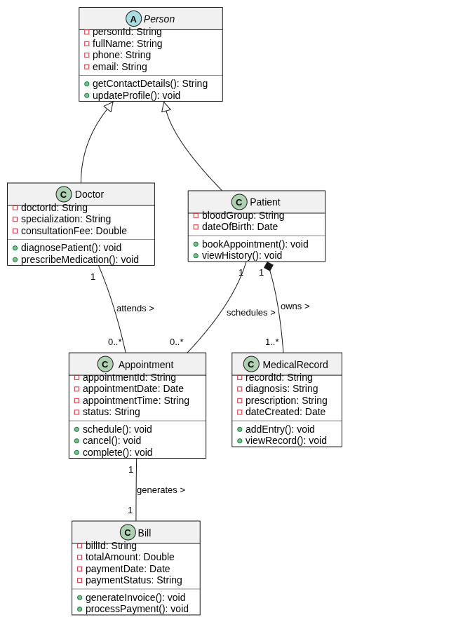

# Outpatient Clinic Management System (OCMS) - UML Class Modelling

## Project Overview
This project presents an object-oriented UML Class Model for an Outpatient Clinic Management System (OCMS). The system manages the relationships and processes between clinic patients, medical doctors, consultation appointments, diagnostic medical histories, and consultation billing.

## Student Information
- **Name:**  [Safi Alden Adam Safi Alkhalefa]
- **Student ID:** [202512802]
- **Institution:** Kigali Independent University (ULK)
- **Course:** UML Class Diagram Modelling
- **Instructor:** Eric Maniraguha

## System Classes
- **Person (Abstract):** Base entity containing common demographic properties.
- **Patient & Doctor:** Inherit demographic properties from `Person`.
- **Appointment:** Connects `Patient` and `Doctor` for scheduled consultations.
- **MedicalRecord:** Holds diagnostic and prescription records linked by composition to `Patient`.
- **Bill:** Generates payment invoices for completed appointments.

## Electronic Diagram Preview

## Repository Structure
- `documentation/`
  - `report_1_project_description.pdf`: Details project scope, requirements, and class responsibilities.
  - `report_2_uml_class_diagram.pdf`: Contains the UML class model and relationship descriptions.
- `diagrams/`
  - `uml_class_diagram.drawio`: Editable diagram file created using draw.io.
  - `uml_class_diagram.png`: Exported high-resolution diagram image.
